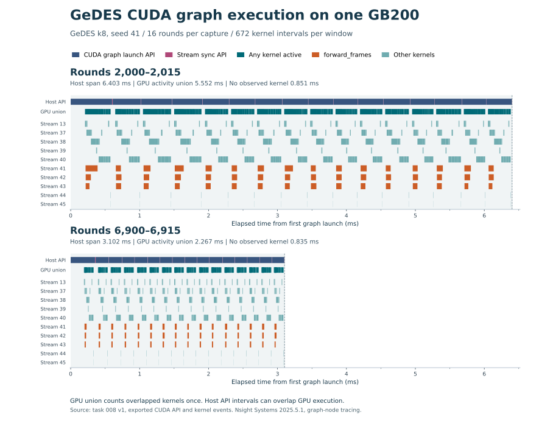
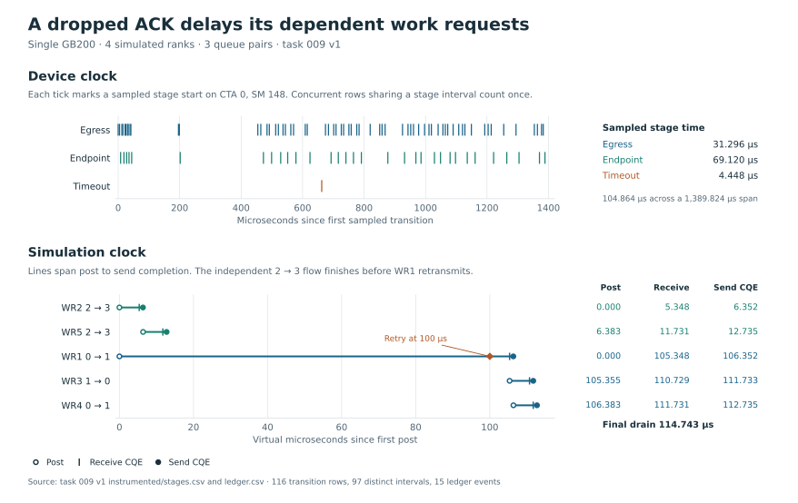

# 单卡 GB200 测量报告 · 2026-11-18

这六项实验都在一张物理 GB200 上运行。研究目标是让 GPU 计算一群虚拟机器之间怎样发包、排队、确认和重传。007 和 009 使用一个小型可靠传输模型，008 使用已有的 GeDES 网络仿真器，010–012 从仿真器要做的工作中抽出排队、解析和提交等环节，各自设计小程序测量。本轮尚未运行一次完整的大模型训练迭代。

阅读数字时先分清两个时钟。**仿真时间**回答“模型中的机器在什么时候收到了包”。例如，丢确认包会让模型中的发送端等 100 µs 才重传。**真实耗时**回答“GB200 和主机花了多久把这些事件算出来”。模拟这段等待时，程序可以把仿真时钟直接推进到下一个事件。007 报前一种时间，008 对照两种时间，009 将两条时间线分别记录，010–012 比较实现时使用真实耗时。

本次收到 007–012 六个 v1 原始包。六项运行的源码提交均为 `32afe699578c4bdd5df9a1c3fb8a9770fa5f7811`，均早于实施任务暂停的 `0b0755c`。六份回执与原包 SHA-256、固定提交的任务清单、领取标识和运行终态一致。每项用一张 GB200。008 实测驱动 580.105.08、计算能力 10.0、nvcc 13.0.48；同一主机在 000 v3 盘点中记录了 Linux 6.6.71（aarch64，64 KiB 页）。按 [plan.md](../plan.md) 的主要指标，准备训练输入至排空并写完结果的 Dense/MoE 迭代墙钟时间仍待测量。

## 007 · 遇到丢包时，GPU 算出的通信结果正确吗？

先让一张卡模拟四个通信参与者（rank 0–3）。虚拟时刻 0，rank 0 向 1 发送一条消息，同时 rank 2 向 3 发送另一条消息。两对使用独立端口。后续还有三次发送，只有各自依赖的收包或发包完成后才能提交。这就是这里的“闭环”。一次发送请求叫 WR，完成通知叫 CQE。输入的每条消息为 8,193 B，恰好拆成 4,096、4,096、1 B 三个包，可以检查最后那个不满一包的字节有没有交付。在这个简化模型中，发送端收到对端确认（ACK）才发下一段。

同样五条请求分别在无故障、丢首个数据包、丢首个确认包、接收端临时未就绪（RNR）四种条件下运行。CPU 与 GPU 各算一遍，核对谁先提交、哪一端何时完成、收发了多少字节、是否重传或重复交付。下表的“排空”还计入了最后的协议收尾。另两例将参与者增至八个，分别使用环形传递（每个参与者向下一位邻居传数据块，共七轮）与全互发（每人向另外七人发送，全部可在起点提交）。两种通信安排都有 56 次发送。

007 的六个简化 RC 用例均通过同实现的标量 CPU 参考与 GPU 核对。下表时间取自**仿真时钟**。每个 WR 为 8,193 B。

| 用例 | WR 数 | 最后一个发送 CQE / 排空（µs） | 协议现象 |
| --- | ---: | ---: | --- |
| 4 rank 闭环，无故障 | 5 | 12.735 / 14.743 | 15 个数据包，无重传 |
| 闭环，丢一个数据包 | 5 | 112.735 / 114.743 | 一次重传 |
| 闭环，丢一个 ACK | 5 | 112.735 / 114.743 | 一次重传，一次重复数据 |
| 闭环，一次 RNR | 5 | 18.907 / 20.915 | 一次 RNR，一次重传 |
| 8 rank Ring | 56 | 44.464 / 46.472 | 创建并关闭 8 个 QP |
| 8 rank All-to-all | 56 | 7.360 / 9.392 | 创建并关闭 56 个 QP |

## 008 · GeDES 的尾段为何更短

GeDES 在一张卡上模拟一棵 k=8 的胖树网络，有 128 台虚拟主机和 80 台虚拟交换机。主机两两配对，每对在两个方向各发一条 TCP 流，共 128 条。固定随机种子让三次运行使用同一批流大小和开始时刻。一轮中，CPU 启动一次预先组织好的 GPU 计算步骤（CUDA Graph），其中的 GPU 函数（kernel）处理协议、交换转发、链路与定时器。同步结束后进入下一轮，每轮推进 1 µs 仿真时间。

同样推进 16 轮，接近结束时会少做多少工作？先关掉分析工具完整跑一次，再用 Nsight Systems（nsys）完整跑两次，一次记录繁忙时的 16 轮，一次记录尾部的 16 轮。每个窗口都推进 16 µs **仿真时间**，下表的毫秒数则是这些轮次在**真实机器**上花的时间。设备活动取所有执行区间的并集，两条并行执行的工作只计一次。

GeDES 上游提交 `1376c638a0ae66116430f953da137d0c536675ad`，补丁后 Release 二进制 SHA-256 为 `0250b851bde3128966451d8f697c37378ab9ed106188ac2e135d78df58dad5c1`。k8、seed 41。正常、忙段采集、尾段采集均完成 7,001 轮、128/128 条流及 24/24 个 channel block。计划、生成和确认字节数均为 1,546,185,260，待完成流为零，12 类队列均排空。三份 FCT 文件逐字节相同，最小、中位、最大值分别为 0.126336、0.949790、2.789285 ms。

| 实测量 | 忙段，第 2,000–2,015 轮 | 尾段，第 6,900–6,915 轮 |
| --- | ---: | ---: |
| 起点仍活跃的流（由 FCT 起止重建） | 53 | 1 |
| 图启动 / kernel 实例 | 16 / 672 | 16 / 672 |
| 首次图启动至最后一次 stream 同步返回 | 6.403 ms | 3.102 ms |
| 设备活动区间并集 | 5.552 ms（86.7%） | 2.267 ms（73.1%） |
| 窗口内未观测到设备活动 | 0.851 ms | 0.835 ms |
| 主机停留在 cudaGraphLaunch 的时间 | 6.346 ms | 3.047 ms |
| 主机停留在 cudaStreamSynchronize 的时间 | 0.048 ms | 0.046 ms |

在十条 stream 上累计各次 `forward_frames` 的时长，忙段为 3.822 ms，尾段为 1.106 ms，两窗均居各 kernel 之首。不同 stream 可以并行执行，累计时长仅用于选择采样对象。活动并集也只表示设备有被观测到的工作，SM 使用率需要独立测量。主机 API 区间与设备执行大量重叠。尾段空隙的占比上升，绝对值却少了约 16 µs；现有数据优先支持活跃流减少、设备工作变短的解释。两窗各采一次，每轮具体处理了多少帧、同一 kernel 内有多少可运行队列仍待采集。

正常运行的进程与仿真循环分别为 **2.311 s、1.648 s**。启用节点级采集后，忙段一趟为 7.610 s、4.699 s，尾段一趟为 7.382 s、4.640 s。进程时间包含采集器开销。正常循环与采集循环本身也相差约 2.8 倍。性能判断采用关闭 profiler 的独立配对重复。

## 009 · 丢了一个确认，哪些发送必须等，哪些还能继续？

沿用 007 的四人、五次发送用例，只看 0→1 的第一个包已经到达、但返回的 ACK 丢失这一种情况。此时 rank 1 要等收完才能回复 rank 0，另一对 rank 2 和 3 则可以继续通信。分析工具若只显示“GPU 正在运行一个函数”，读者无法知道里面在处理哪条消息。

在同一个 CUDA 程序内加上记录点，处理发包、到达和超时时写下实际设备时间、仿真时间、消息编号和所用线程块。对照运行分为 CPU/GPU 参考校验、普通 GPU、打开记录的 GPU 三次。三次运行的 15 行提交和完成记录完全相同，摘要均为 `13889af10e388cf4`。三次均创建、关闭 3 个 QP，发送与接收 CQE 各 5 个，载荷 40,965 B，线上 94,986 B。

- **真的要等待的操作。** 0→1 的 WR1 在虚拟时刻 100.000 µs 超时重传。它在 105.348 µs 的接收完成使 WR3 于 105.355 µs 提交，在 106.352 µs 的发送完成使 WR4 于 106.383 µs 提交。
- **可独立推进的操作。** 2→3 的 WR2 在 6.352 µs 发送完成，WR5 于 6.383 µs 提交，12.735 µs 已发送完成。与 007 无故障对照相比，整例最后的发送完成与排空均恰好延后 100 µs。
- **设备实际做了多久。** 单 CTA 在 SM 148 留下 116 行完整插桩。合并同批次的重复区间后，97 个区间覆盖 104.864 µs，其中 egress 为 31.296 µs、endpoint 为 69.120 µs、timeout 为 4.448 µs。首末采样间的设备实时时间跨度为 1,389.824 µs。其余时间可能含未插桩代码、跨次 kernel 调用的间隔及主机工作。普通、插桩进程各一次，耗时 0.531、0.560 s，尚不能估计稳定插桩开销或多 CTA 均衡度。

005 的固定无环对照也观察到独立进度提前。全局与局部安全边界均提交 16 个事件、与 CPU 账本一致并排空；独立 sink 首波完成数从 2 增至 4。放宽同刻边界的负对照也排空，但输出次序摘要失配。这说明检查每个 owner 的顺序能发现总计数漏掉的错误。

## 010 · 包数一样，只改热点分布和分工，GPU 会算多久？

这个小程序模拟 32,768 个独立的输出端口。每个端口从两路输入按到达时刻挑下一个包，根据它的到达时刻、包长和前一个包的发送结束时刻，算出它何时发完，并更新顺序和字节数。“owner”就是负责这一个端口状态的计算单元。两套输入的总包数和字节数相同，都给所有端口少量基础流量，仅把额外的包集中给一个端口或平摊给 64 个端口。

输入分 12 批公布。程序面对两个独立选择。第一种选择决定能处理到哪个虚拟时刻。共用边界时，所有端口都要考虑全局最早的未公布事件。用局部边界时，每个端口只需考虑自己的两路输入。第二，GPU 线程块固定负责一组端口，还是处理完一组再领取下一组。两项交叉形成四种算法。每组有 32 个端口，每个端口仍由一个线程按顺序处理。即使另一线程块空闲，它也只能领取另一组端口。计时从输入已在卡上开始，到 12 批处理完并完成 GPU 同步为止。

010 固定 32,768 个独立 FIFO owner、2,097,152 个事件、1,140,850,688 B、12 波。每个变体预热后做五次轮换顺序的配对测量。下表为常驻循环墙钟中位数，包含边界/就绪队列 kernel 和同步，排除初始上传、重置、结果回读及文件。

| 额外负载分布 | 全局边界＋静态 | 全局＋动态 | 局部＋静态 | 局部＋动态 |
| --- | ---: | ---: | ---: | ---: |
| 1 个热点 owner | 117.711 ms | 118.278 ms | 117.638 ms | 118.623 ms |
| 64 个热点 owner | 3.487 ms | 3.568 ms | 3.527 ms | 3.621 ms |

局部静态将第一波由零事件推进至单热点 131,068、多热点 173,908 个事件。全局静态将 2,061,984 个事件留到末波。提前可提交的工作改变了波次分布，动态领取 tile 在这两组数据上都没有带来净收益。每个 owner 由一个 lane 按序提交，领取 tile 不能分担单个 owner 的提交。单热点与 64 热点的 33.8 倍差距取自相同全局静态算法；本例没有分别实现真实热 QP 和热交换机出口。两种负载的故意违规对照均在事件数、字节数相同时产生错误的顺序摘要。

## 011 · 收到一批包，分两道 GPU 工序还是合在一道更快？

输入为 512 个独立队列，每个队列给 32 或 1,024 条包记录。每条记录有序号、长度、到达时刻等字段。每组连续的 13 条中，最后一条重复前一包的序号和载荷长度。GPU 要先解析记录，再依次判断每个包是否应该接收、累计交付多少字节、是否完成一条消息。两个相邻包的字段可以同时解析，第二个包能否计入交付却取决于第一个包更新后的状态。程序必须为每条记录写出答案，与 CPU 参考逐条比对。

试验用了三个开关，共八种组合。① 解析和更新队列分成两次 GPU 函数调用，通过显存传中间结果，或合成一次，在块内交接。② 让线程一起加载数据，或专门安排一组 32 个线程预取下一批。③ 每批拷回主机并写完再继续，或用两块缓冲区，让输出与后续批次的处理有机会重叠。表中可以固定两个开关，只比较第三个开关的效果。

每组预热后交错测五次，下表为中位数（ms）。计时含 kernel、同步、D2H、写出至文件关闭，排除 fixture 生成、初始 H2D、分配与验证；文件关闭未要求持久化 fsync。

| 每队列深度 | 阶段 | 协作加载＋同步写出 | producer warp＋同步写出 | 协作加载＋双缓冲 | producer warp＋双缓冲 |
| --- | --- | ---: | ---: | ---: | ---: |
| 32 | 拆分 | 7.213 | 6.466 | 6.500 | 6.877 |
| 32 | 融合 | 6.920 | 6.449 | 6.708 | 6.479 |
| 1,024 | 拆分 | 11.583 | 11.722 | 10.721 | 10.730 |
| 1,024 | 融合 | 10.857 | 10.495 | 10.467 | 10.851 |

深队列、协作加载、同步写出时，单独融合使五对测量均缩短，中位数从 11.583 降到 10.857 ms（−6.3%）。浅队列相同对照的五对方向不一致。深队列融合后加 producer warp 或双缓冲的最低两个中位数仅差 0.028 ms；两项叠加还有一次 33.237 ms 样本。当前可选择融合做单因素复验，尚不能选出通用的最优流水线。两种深度核对的输出分别为 393,216 和 12,582,912 B。

## 012 · 同一个接收函数，把循环展开能否再快一些？

复用 011 的深队列输入，共 512 × 1,024 = 524,288 条包记录。固定解析与更新融合、线程协作加载、同步写出，只改编译时的一项设置，把有序提交的循环按 1、4、8 三种因子展开。展开让编译器在循环体内放入多份处理指令，有机会减少循环判断，也会增大函数的机器码。三组依然按同样的次序处理同样多的包。

这个任务同时看两个量。一是工作从 GPU 处理一直到输出文件关闭究竟用了多久。二是反汇编后，实际执行的函数包含多少条静态机器指令（SASS），编译器为每个线程分配了多少寄存器。要把“代码变长”和“耗时变长”联系到具体的取指瓶颈，还需要硬件计数器。

每档展开因子做五次计时，输出 SHA-256 均与 011 同深度参考相同。静态数据取实际执行的 `decode_tiles<true,false>`。

| 展开因子 | 至关闭文件的中位数 | 静态 SASS 指令数 | 每线程寄存器 | spill 读 / 写 |
| --- | ---: | ---: | ---: | ---: |
| 1 | 11.080 ms | 128 | 28 | 0 / 0 B |
| 4 | 11.109 ms | 256 | 32 | 0 / 0 B |
| 8 | 11.433 ms | 416 | 32 | 0 / 0 B |

更大的展开没有改善这批中位数。NCU 日志记录三档均成功生成报告，首次匹配的 launch 属于预热；回包仅列可用指标名，缺少实际计数。当前无法把差异归因于指令缓存 miss，或计算 kernel 单独的耗时差。可先从 CPFS 上的三个 `instructions.ncu-rep` 导出指标值，再对正常迭代的代表性 launch 单独采样。

## Nsight Systems 版本选择

008 实际版本为 **2025.5.1.121-255136380782v0**。截至 2026-11-18，NVIDIA 提供的最新版本为 **2026.6.1**，有适配 Grace 的 Linux Arm Server CLI。现有驱动和 CUDA 13.0 编译的程序可先做兼容性实测。新版增加对 CUDA 13.5 的支持。当前 GPU 实验无需据此升级 Linux 内核或重编 CUDA 程序。[NVIDIA 下载、平台与系统要求](https://developer.nvidia.com/nsight-systems/get-started)

| 自 2025.5.1 以来的变化 | 针对本项目的用途 |
| --- | --- |
| 2025.5 已提供可选 Blackwell 硬件追踪，2025.6.1 起在支持环境中默认用 HES，可用 `--trace=cuda-sw` 强制软件采集。2026.6.1 修复多项 Blackwell HES 问题。 | 短 kernel 和 42 节点/轮的图最值得复测。回包中的 008 使用旧版 `--trace=cuda`，没有显式请求当时的硬件模式。新版可自动回退，须保留 Diagnostics Summary 记录实际方式。[旧版说明](https://forums.developer.nvidia.com/t/nsight-systems-2025-2-1-desktop-server-x86-64-arm-sbsa-release-announcement/327618) · [默认模式变更](https://forums.developer.nvidia.com/t/nsight-systems-2025-6-1-desktop-server-x86-64-arm-sbsa-release-announcement/352230) · [新版追踪方式](https://docs.nvidia.com/nsight-systems/UserGuide/#cuda-trace-methods) |
| 2026.2.1 支持在硬件采集下跟踪设备发起图的节点。此后增强图上的 NVTX 投影，2026.6.1 覆盖子图及批量拷贝。2026.5.1 增加工作队列 channel ID 和数量。 | 区分提交来源、图节点和队列。008 当前的图由主机提交。跟踪硬件工作队列不会提供仿真内每个 QP 的状态。[2026.2.1 公告](https://forums.developer.nvidia.com/t/nsight-systems-2026-2-1-desktop-server-x86-64-arm-sbsa-release-announcement/363908) · [历版功能](https://developer.nvidia.com/nsight-systems/get-started) |
| 2026.6.1 新增 CTA/CGA occupancy 提示、同步 API 的 stream 信息、`nsys survey` 和 `nsys query`，并改进 NCCL 多 rank 分析。 | 对照 host/device 时间和导出可核验的汇总。模拟 RC 依赖仍需 009 的应用账本与设备插桩；真实 NCCL 作业才适用其集合通信分析。[2026.6.1 发布说明](https://docs.nvidia.com/nsight-systems/ReleaseNotes/index.html) |

## 下一项对照如何区分原因

| 当前证据 | 未决问题 | 建议实验与判据 |
| --- | --- | --- |
| 008 两窗口空隙绝对值接近，节点级采集下循环明显变慢 | 有多少来自采集扰动，有多少来自每轮固定工作或有效帧数变少 | 固定同一二进制、GPU、驱动、输入和窗口，比正常运行、旧版软件、新版软件、新版默认采集。新版固定主机发起的节点粒度，判读 Diagnostics Summary 后才标记 HES。各至少五次配对；复核每窗 16 启动、672 节点、输出和排空。另采 graph 粒度测整图跨度，独立记录每轮有效帧/活跃队列。 |
| 009 看到 WR 等反馈时独立 rank 仍能推进，设备实时时间存在大量未覆盖区间 | 未覆盖区间里有多少是主机推进、kernel 间隔和 kernel 内其余工作 | 在同一 RC 可执行文件上配对采集主机 API、kernel 起止与设备阶段，先保留单 CTA 参考。评估多 CTA 时另列每个 owner 的积压、可提交工作和提交顺序。 |
| 010 单热点集中后耗时显著增加，动态分配 tile 未改善 | 固定顺序的状态提交能分解多少；训练中是否出现同类热点 | 优先做一个新 CUDA kernel 原型，用多 lane 并行解码/准备同一 owner 的工作，再按参考顺序提交。与现有 kernel 固定事件与输出配对，核对每 owner 的顺序、字节、终态及排空，单列准备和提交耗时。真实训练另采 QP/端口负载分布。 |
| 011 深队列融合的单因素对照五对均更快；012 加大展开后代码变长 | 赢在减少中间流量、启动、设备执行还是写出；是否有取指停顿 | 在上述原型单测中保留拆分对照与展开 1 基线，分别测 kernel、D2H、文件关闭。读 NCU 实测寄存器、驻留及取指停顿，确认后再放回同一 Dense/MoE 训练迭代比较端到端时间。 |

本地原始包和提取数据在各任务的 `results/<id>-<slug>/`。008 的两个 `timeline.json` 与 009 的 `stages.csv`、`ledger.csv` 可重建图；原生 Nsight 报告未随小包下载。原包指纹可查 [007](../status/007-training-roce-checks/v1.archived.json)、[008](../status/008-gedes-timeline/v1.archived.json)、[009](../status/009-training-roce-profile/v1.archived.json)、[010](../status/010-training-owner-sweep/v1.archived.json)、[011](../status/011-rc-stage-pipeline/v1.archived.json)、[012](../status/012-rc-instruction-profile/v1.archived.json) 的归档回执。
